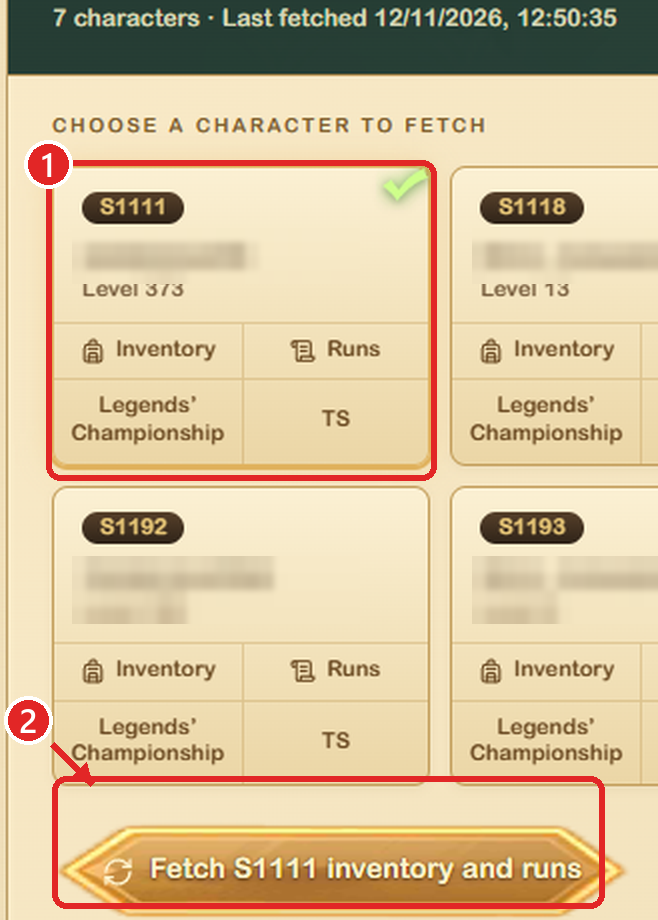

# AFK-Community

A desktop app for **AFK Arena** players. It helps you build your fastest **Nightmare Corridor** rotation from the heroes you actually own, compare your teams with your friends' teams, and see exactly what you're missing to go faster.

Everything runs on your PC. Your data stays in the app folder and is never uploaded anywhere.

## ⬇ Download (Windows)

| | |
|---|---|
| **[Installer — AFK-Community-setup.exe](https://github.com/shredia/AFK-Community/releases/latest/download/AFK-Community-setup.exe)** | Recommended. Run it and you're done. |
| [Portable — AFK-Community-portable.zip](https://github.com/shredia/AFK-Community/releases/latest/download/AFK-Community-portable.zip) | No installation: unzip it and open the `.exe`. |

All versions and their changes: [Releases](https://github.com/shredia/AFK-Community/releases).

> **Note:** the direct connection to esperianarchive.com (login, fetch, run downloads) is **in development**. Meanwhile, the app works with the files you download from the site yourself (see *Getting started*).

---

## Installation

**Installer (recommended):**

1. Download **AFK-Community-setup.exe** (link above) and run it. It doesn't need administrator rights.
2. Open **AFK-Community** from the Start menu (or the desktop shortcut).

The app is installed in `%LOCALAPPDATA%\Programs\AFK-Community`, and your data is kept in that folder. To uninstall it, use *Settings → Apps*; it asks whether to keep your data.

**Portable (no installation):**

1. Download **AFK-Community-portable.zip** (link above).
2. Unzip it anywhere you can write, for example in `Documents` (not in `C:\Program Files`).
3. Open `AFK-Community.exe`. The folder contains just the `.exe`, the `app` folder and this README: keep them together, the `.exe` doesn't work on its own.

The app checks GitHub for new versions and offers to update itself.

## Getting started

### Step 1: refresh your data on the site

Before downloading anything, ask the site to read your latest game data:

1. Log in to **esperianarchive.com**.
2. Open your account options → **[Game accounts](https://esperianarchive.com/game-accounts)**.
3. **①** Select the character (server) you play on.
4. **②** Press **Fetch … inventory and runs** and wait until it finishes (usually less than a minute).

<p align="center">
  
</p>

### Step 2: download the files

- `afk-runs.json` from **[My runs](https://esperianarchive.com/my-runs)**: your runs.
- `afk-inventory.json` from **[Inventory](https://esperianarchive.com/inventory)**: your account (heroes, collections, pets, resources).

The **🌐 My runs** and **🌐 Inventory** buttons in the app open those pages for you.

### Step 3: import them into the app

1. Go to **Settings → Import / export → Choose file and import…** and import both files.
2. Open **Optimizer** and press **▶ Optimize**.

Repeat these steps whenever you play new runs or upgrade your heroes. Importing again only adds what's new.

## What you can do

### Optimizer
Finds the best team for each of this week's 6 bosses **without repeating heroes** (and, optionally, without repeating pets).

- **★ Summary:** one card per boss showing the chosen team, its time and the big total time. If a friend clears a boss faster, the card tells you, and whether you could copy that team.
- **Boss tabs:** your teams next to another source's teams. You see the differences between the two teams and between the builds of the heroes they share (SI, engraving, furniture, collection, gear). You also get a table of every hero used against that boss and who is faster with it.
- **🎯 What I'm missing:** your friends' teams that beat yours, how many seconds you'd gain and what you lack to build them: a hero, SI level, engraving, furniture, collection or pet. At the top it lists the single upgrades that gain you the most time.
- **📊 Statistics:** damage, % of total damage, healing, defense, kills, energy and HP for each hero in every round, plus your pet's damage and the boss's remaining HP.
- **⌕ Explore:** every team used against any boss, or your full runs sorted by total time.
- **Hero detail:** click any portrait to see its full build, which collections the guide recommends for it, and buttons to ban or limit it.

### ⚙ Configure (inside the optimizer)
- **Sources:** what to optimize with. Your runs, another server of yours, one friend, all friends, or any mix. Each boss can come from a different source.
- **Blocks:** heroes or pets you don't want to use, collections you don't have, and build limits (for example, "Dracula: SI max 20" or "any collection: max ★2"). Each rule can apply to all teams, only yours or only your friends'. Active rules show up as chips under the optimizer header; click a chip's ✕ to disable that rule.
- **My roster:** what you own, taken from your inventory. You can fix anything by hand, which helps when the inventory is outdated.
- **Search:** complete runs only; no borrowed or trial heroes; use only friends' teams you can build (✅) or almost build (🟡).
- **View:** portrait size.

### Special Power (SP)
Only special heroes (Fawkes, Thoran, Eluard, …) have an SP. Their portraits show an **SP** badge:

- **Gold:** the hero used its SP that round.
- **Gray and crossed out:** the hero didn't use it.
- **Red "SP?":** the team had two or more special heroes and the file doesn't say which one was chosen. Open the hero's detail and click **"{hero} used it"** to save your answer.

If a team has only one special hero, the app marks that hero automatically, because its SP activates on its own.

### Borrowed, rented and trial heroes
- **Borrowed** (mercenaries) come as their owner built them. They're labeled, and you can exclude them.
- **Rented dimensional heroes** (e.g. Albedo) are **yours**: you ascend and equip them. The app treats them as your own heroes.

### Weekly progress
A chart and a table of your best complete run each week, plus the sum of your best time on each boss that week. It also compares each week with the last time you faced the same bosses.

### Friends
Import a friend's `afk-runs.json`, or a shared runs file they send you. The optimizer can mix their teams with yours, and **What I'm missing** shows what to copy from them. In this section you can also rename friends, optimize with their runs, or send them to the Recycle Bin.

### My account
Your resources, heroes, collections, gear and pets from your last inventory import. For each hero you see its build, whether its collection meets the guide's recommendation, and how you've done with it in NC.

### Temporal Rift
A planner for the floor rewards, choice chests and medal shops, up to your Friday goal.

### Import / export
- **Import:**
  - `afk-runs.json`: runs.
  - `afk-inventory.json`: account.
  - Shared runs files.
  - `.zip` backups.

  If you import `afk-runs.json` again, runs you already have aren't duplicated; they just get their statistics added.
- **Export runs to share (.json):** your NC runs including **who used the SP in each round** and the statistics. Send this file to friends; plain `afk-runs.json` doesn't record the SP.
- **Export .zip:** a full backup of a server or a friend, to move it to another PC.

### Language
English and Spanish. You can switch in **Settings → General**.

## Privacy

- Everything is stored inside the app's `app/` folder (`cuentas/`, `preferencias.json`, …).
- If you used the site login, the password is stored in the Windows Credential Manager, not in a file.
- The app only goes online to check GitHub for updates (and, once it's re-enabled, to connect to esperianarchive.com).
- The portable build ships **without any personal data**.

## For developers

```bash
python -m venv .venv
.venv\Scripts\pip install -r requirements.txt
.venv\Scripts\python main.py                        # run from source
.venv\Scripts\python -m idiomas actualizar          # add new UI strings to idiomas/*.json
.venv\Scripts\python herramientas\construir_exe.py  # build dist/AFK-Community, the portable .zip and setup.exe (needs Inno Setup 6)
.venv\Scripts\python -m navegador.actualizador publicar X.Y.Z   # tag and publish a version
```

The `.exe` is only a launcher. Its `app/` folder holds Python and its libraries, the app code (`aplicacion/`, `navegador/`, `idiomas/`, `recursos/`) as `.py` files, so it can be updated from GitHub, and the user's data.

To publish a version: `publicar X.Y.Z` (above), then build, then upload `dist/AFK-Community-setup.exe` and `dist/AFK-Community-portable.zip` to the GitHub Release of tag `vX.Y.Z`, keeping those exact file names (the download links point to them).
